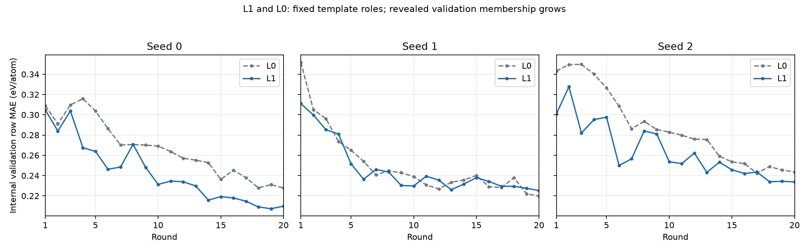

# H4 stage4.4 对照与迁移

状态：complete。阶段4.4完成，H4结束；不启动H5或其他阶段，等待用户决定下一步。

全部结果取自已提交的预测、一次性评分与私有组bootstrap抽样缓存；报告不训练、不重新预测、不读取评测标签。
MAE/RMSE单位eV/atom；R²无量纲。2000次组bootstrap；三个种子的指标及抽样值取算术平均，不是预测ensemble。
合成按完整TEST1000模板分组；真实按完整HOLDOUT2000约化成分分组。

## 评分历史与范围

本阶段合成TEST一次读取覆盖12对照臂，H4累计从3增至4；原O/L0/L1不重新评分。
本阶段真实DFT HOLDOUT一次读取覆盖全部12迁移臂，不用HOLDOUT修改模型、特征或失败率筛选。
历史HOLDOUT实际标签字段累计读取次数无法确认；可识别的H2/H3/H3b历史终评记录与本次新增1次分开记录，不能把marker数当成全部字段读取次数。
4.3 PermissionError原trace未记录具体文件名，无法确认；当前可读性核验不能证明原因为临时占用。
迁移使用H2初始/original DFT几何及DFT标签；不将H3的CHGNet弛豫结构缓存称为原始DFT结构。Magpie仅复用已核对成分的缓存。

## 合成对照绝对指标

|Group/comparison|Seed|Weighting|MAE [95% CI]|RMSE [95% CI]|R2 [95% CI]|
|---|---|---|---|---|---|
|HGB_Magpie132_n2000|0|row_weighted|0.236164 [0.217751, 0.256813]|0.345028 [0.303942, 0.393288]|0.894410 [0.863319, 0.917298]|
|HGB_Magpie132_n2000|0|group_weighted|0.253202 [0.229865, 0.280157]|0.376327 [0.318430, 0.448681]|0.880623 [0.838129, 0.911979]|
|HGB_Magpie132_n2000|1|row_weighted|0.232139 [0.214297, 0.251141]|0.338888 [0.301697, 0.381559]|0.898134 [0.868922, 0.919212]|
|HGB_Magpie132_n2000|1|group_weighted|0.251118 [0.227229, 0.276565]|0.373390 [0.322959, 0.426471]|0.882479 [0.852314, 0.908826]|
|HGB_Magpie132_n2000|2|row_weighted|0.232140 [0.214644, 0.251732]|0.335128 [0.299546, 0.375648]|0.900382 [0.875220, 0.919704]|
|HGB_Magpie132_n2000|2|group_weighted|0.248237 [0.224615, 0.274663]|0.370185 [0.312789, 0.442832]|0.884488 [0.843315, 0.914908]|
|HGB_Magpie132_n2000|arithmetic mean|row_weighted|0.233481 [0.216855, 0.252559]|0.339681 [0.303787, 0.381854]|0.897642 [0.870927, 0.917595]|
|HGB_Magpie132_n2000|arithmetic mean|group_weighted|0.250852 [0.228684, 0.275736]|0.373301 [0.319834, 0.437091]|0.882530 [0.846285, 0.910664]|
|HGB_Magpie132_n5000|0|row_weighted|0.210115 [0.194800, 0.226874]|0.295782 [0.269368, 0.323970]|0.922400 [0.905638, 0.935700]|
|HGB_Magpie132_n5000|0|group_weighted|0.221865 [0.203205, 0.242568]|0.317573 [0.281773, 0.358337]|0.914989 [0.895447, 0.930817]|
|HGB_Magpie132_n5000|1|row_weighted|0.210115 [0.194800, 0.226874]|0.295782 [0.269368, 0.323970]|0.922400 [0.905638, 0.935700]|
|HGB_Magpie132_n5000|1|group_weighted|0.221865 [0.203205, 0.242568]|0.317573 [0.281773, 0.358337]|0.914989 [0.895447, 0.930817]|
|HGB_Magpie132_n5000|2|row_weighted|0.210115 [0.194800, 0.226874]|0.295782 [0.269368, 0.323970]|0.922400 [0.905638, 0.935700]|
|HGB_Magpie132_n5000|2|group_weighted|0.221865 [0.203205, 0.242568]|0.317573 [0.281773, 0.358337]|0.914989 [0.895447, 0.930817]|
|HGB_Magpie132_n5000|arithmetic mean|row_weighted|0.210115 [0.194800, 0.226874]|0.295782 [0.269368, 0.323970]|0.922400 [0.905638, 0.935700]|
|HGB_Magpie132_n5000|arithmetic mean|group_weighted|0.221865 [0.203205, 0.242568]|0.317573 [0.281773, 0.358337]|0.914989 [0.895447, 0.930817]|
|CGCNN_n2000|0|row_weighted|0.172658 [0.161368, 0.184550]|0.232187 [0.216451, 0.248338]|0.952182 [0.944826, 0.958451]|
|CGCNN_n2000|0|group_weighted|0.189158 [0.175153, 0.203631]|0.252837 [0.231765, 0.274820]|0.946114 [0.936822, 0.954150]|
|CGCNN_n2000|1|row_weighted|0.168625 [0.156908, 0.180322]|0.236728 [0.218035, 0.256521]|0.950293 [0.941415, 0.957513]|
|CGCNN_n2000|1|group_weighted|0.188068 [0.171226, 0.207285]|0.273974 [0.238525, 0.311499]|0.936729 [0.922096, 0.949288]|
|CGCNN_n2000|2|row_weighted|0.158205 [0.147555, 0.169134]|0.210613 [0.194423, 0.226710]|0.960655 [0.953917, 0.966322]|
|CGCNN_n2000|2|group_weighted|0.169010 [0.155950, 0.183155]|0.228028 [0.205274, 0.252011]|0.956170 [0.946807, 0.963935]|
|CGCNN_n2000|arithmetic mean|row_weighted|0.166496 [0.157235, 0.175362]|0.226509 [0.212668, 0.240280]|0.954377 [0.948116, 0.959615]|
|CGCNN_n2000|arithmetic mean|group_weighted|0.182079 [0.170407, 0.194137]|0.251613 [0.230658, 0.272891]|0.946338 [0.938112, 0.953158]|
|CGCNN_n5000|0|row_weighted|0.106223 [0.098836, 0.113873]|0.148985 [0.135856, 0.162825]|0.980312 [0.976333, 0.983687]|
|CGCNN_n5000|0|group_weighted|0.116379 [0.106477, 0.126630]|0.164857 [0.147550, 0.182064]|0.977091 [0.972646, 0.981151]|
|CGCNN_n5000|1|row_weighted|0.126922 [0.118293, 0.135150]|0.173993 [0.158115, 0.190698]|0.973148 [0.967213, 0.978047]|
|CGCNN_n5000|1|group_weighted|0.138033 [0.126968, 0.149149]|0.191147 [0.171690, 0.209732]|0.969202 [0.962556, 0.975241]|
|CGCNN_n5000|2|row_weighted|0.107939 [0.099954, 0.116553]|0.154358 [0.140018, 0.168677]|0.978866 [0.974597, 0.982536]|
|CGCNN_n5000|2|group_weighted|0.119455 [0.108879, 0.131042]|0.174025 [0.153924, 0.194625]|0.974472 [0.968923, 0.979550]|
|CGCNN_n5000|arithmetic mean|row_weighted|0.113695 [0.107177, 0.120265]|0.159112 [0.146132, 0.172714]|0.977442 [0.973016, 0.981005]|
|CGCNN_n5000|arithmetic mean|group_weighted|0.124622 [0.115231, 0.134142]|0.176676 [0.158948, 0.194156]|0.973588 [0.968373, 0.978046]|

历史参考：原H4协议给定的H3零样本LLM特征在2000标签下合成MAE约0.212，保留其原评测样本/结构口径。该数仅引用，不当成本阶段TEST1000新统计，不为它新增评分或配对CI。

## 真实DFT迁移绝对指标

原协议的各臂最终特征集包含O/L0/L1，每臂三个种子；另有三个Magpie-only HGB基线。只在真实TRAIN重新应用>20%失败剔除及训练中位数填补，不重新选择合成轮次。
固定TRAIN成员及固定HGB参数可能使三个Magpie基线预测完全相同；这些不是独立随机重复，共享组抽样不会凭重复副本缩窄CI。

|Group/comparison|Seed|Weighting|MAE [95% CI]|RMSE [95% CI]|R2 [95% CI]|
|---|---|---|---|---|---|
|O|0|row_weighted|0.198883 [0.185221, 0.212317]|0.314365 [0.290284, 0.340720]|0.925385 [0.913696, 0.935363]|
|O|0|group_weighted|0.204991 [0.194842, 0.216528]|0.319301 [0.296817, 0.344621]|0.924355 [0.912928, 0.934322]|
|O|1|row_weighted|0.202103 [0.188074, 0.216242]|0.316563 [0.292768, 0.343034]|0.924338 [0.912664, 0.934158]|
|O|1|group_weighted|0.208358 [0.198092, 0.219857]|0.321084 [0.298429, 0.345871]|0.923508 [0.912225, 0.933114]|
|O|2|row_weighted|0.195625 [0.182796, 0.209359]|0.305384 [0.283000, 0.330574]|0.929587 [0.919115, 0.938599]|
|O|2|group_weighted|0.200723 [0.190179, 0.211936]|0.309962 [0.287514, 0.334135]|0.928715 [0.918106, 0.937812]|
|O|arithmetic mean|row_weighted|0.198870 [0.185619, 0.212227]|0.312104 [0.289117, 0.338009]|0.926437 [0.915439, 0.935786]|
|O|arithmetic mean|group_weighted|0.204691 [0.194865, 0.215765]|0.316782 [0.295016, 0.341582]|0.925526 [0.914559, 0.934985]|
|L0|0|row_weighted|0.190237 [0.177288, 0.202986]|0.297310 [0.274197, 0.321110]|0.933261 [0.923293, 0.942171]|
|L0|0|group_weighted|0.195649 [0.185588, 0.206881]|0.302275 [0.280183, 0.325770]|0.932207 [0.922230, 0.940986]|
|L0|1|row_weighted|0.188312 [0.176207, 0.201083]|0.299206 [0.274951, 0.325011]|0.932407 [0.921547, 0.941956]|
|L0|1|group_weighted|0.193655 [0.183543, 0.204553]|0.303744 [0.280419, 0.329228]|0.931547 [0.920445, 0.940826]|
|L0|2|row_weighted|0.195208 [0.182150, 0.208666]|0.312125 [0.286202, 0.339335]|0.926445 [0.914823, 0.936978]|
|L0|2|group_weighted|0.200538 [0.190360, 0.211667]|0.317064 [0.292831, 0.343554]|0.925412 [0.913618, 0.935982]|
|L0|arithmetic mean|row_weighted|0.191252 [0.178950, 0.203899]|0.302880 [0.278874, 0.328711]|0.930704 [0.920093, 0.940138]|
|L0|arithmetic mean|group_weighted|0.196614 [0.186961, 0.207159]|0.307694 [0.284893, 0.332028]|0.929722 [0.918919, 0.939154]|
|L1|0|row_weighted|0.185902 [0.173261, 0.198108]|0.285842 [0.264267, 0.307370]|0.938311 [0.929662, 0.946202]|
|L1|0|group_weighted|0.190488 [0.181105, 0.200246]|0.289685 [0.269317, 0.309870]|0.937737 [0.929240, 0.945541]|
|L1|1|row_weighted|0.191051 [0.177988, 0.203958]|0.299843 [0.275909, 0.324796]|0.932119 [0.921548, 0.941479]|
|L1|1|group_weighted|0.196063 [0.185866, 0.207057]|0.304066 [0.281056, 0.327281]|0.931402 [0.920853, 0.940842]|
|L1|2|row_weighted|0.184875 [0.173045, 0.196819]|0.283085 [0.261592, 0.306187]|0.939495 [0.930293, 0.947231]|
|L1|2|group_weighted|0.189308 [0.180136, 0.199284]|0.286621 [0.266210, 0.309003]|0.939047 [0.929898, 0.946731]|
|L1|arithmetic mean|row_weighted|0.187276 [0.175114, 0.199177]|0.289590 [0.268701, 0.311951]|0.936641 [0.927636, 0.944575]|
|L1|arithmetic mean|group_weighted|0.191953 [0.183030, 0.201581]|0.293457 [0.272988, 0.314661]|0.936062 [0.927015, 0.943797]|
|Magpie_HGB|0|row_weighted|0.222088 [0.205855, 0.238039]|0.367793 [0.333844, 0.401924]|0.897867 [0.880929, 0.913409]|
|Magpie_HGB|0|group_weighted|0.228838 [0.215666, 0.242077]|0.373627 [0.339205, 0.407055]|0.896425 [0.879854, 0.912229]|
|Magpie_HGB|1|row_weighted|0.222088 [0.205855, 0.238039]|0.367793 [0.333844, 0.401924]|0.897867 [0.880929, 0.913409]|
|Magpie_HGB|1|group_weighted|0.228838 [0.215666, 0.242077]|0.373627 [0.339205, 0.407055]|0.896425 [0.879854, 0.912229]|
|Magpie_HGB|2|row_weighted|0.222088 [0.205855, 0.238039]|0.367793 [0.333844, 0.401924]|0.897867 [0.880929, 0.913409]|
|Magpie_HGB|2|group_weighted|0.228838 [0.215666, 0.242077]|0.373627 [0.339205, 0.407055]|0.896425 [0.879854, 0.912229]|
|Magpie_HGB|arithmetic mean|row_weighted|0.222088 [0.205855, 0.238039]|0.367793 [0.333844, 0.401924]|0.897867 [0.880929, 0.913409]|
|Magpie_HGB|arithmetic mean|group_weighted|0.228838 [0.215666, 0.242077]|0.373627 [0.339205, 0.407055]|0.896425 [0.879854, 0.912229]|

## 预登记的既有特征比较

只引用4.3已存私有抽样结果并核对三项六位参考值，未重读标签、未重新bootstrap或修改参考。
L1−L0是整套记忆、反馈和查询轨迹差异，不是纯笔记因果；内部validation标签进入反馈，成员随揭示增长。

|Group/comparison|Seed|Weighting|MAE [95% CI]|RMSE [95% CI]|R2 [95% CI]|
|---|---|---|---|---|---|
|L0_minus_O|0|row_weighted|-0.011812 [-0.023744, -0.000675]|-0.022093 [-0.039673, -0.004081]|0.011262 [0.002077, 0.020932]|
|L0_minus_O|0|group_weighted|-0.013250 [-0.026561, -0.001114]|-0.024757 [-0.043774, -0.007293]|0.012376 [0.003525, 0.022417]|
|L0_minus_O|1|row_weighted|-0.011986 [-0.024331, 0.000177]|-0.028733 [-0.048275, -0.011177]|0.014421 [0.005548, 0.024989]|
|L0_minus_O|1|group_weighted|-0.011919 [-0.024792, 0.000861]|-0.028209 [-0.047355, -0.010003]|0.014206 [0.004996, 0.024708]|
|L0_minus_O|2|row_weighted|0.014419 [0.003056, 0.025433]|0.023352 [0.006985, 0.039997]|-0.012023 [-0.021375, -0.003466]|
|L0_minus_O|2|group_weighted|0.017604 [0.004459, 0.031016]|0.027833 [0.007150, 0.050165]|-0.014362 [-0.026361, -0.003758]|
|L0_minus_O|arithmetic mean|row_weighted|-0.003126 [-0.010755, 0.004133]|-0.009158 [-0.021304, 0.002295]|0.004553 [-0.001274, 0.010892]|
|L0_minus_O|arithmetic mean|group_weighted|-0.002522 [-0.010568, 0.005686]|-0.008378 [-0.021102, 0.004061]|0.004073 [-0.002422, 0.010818]|
|L1_minus_L0|0|row_weighted|-0.002442 [-0.012623, 0.007721]|-0.004445 [-0.018363, 0.009235]|0.002161 [-0.004498, 0.008926]|
|L1_minus_L0|0|group_weighted|0.002421 [-0.008613, 0.013491]|0.002680 [-0.012410, 0.019046]|-0.001290 [-0.009130, 0.006107]|
|L1_minus_L0|1|row_weighted|0.006797 [-0.004823, 0.018136]|0.020641 [0.003112, 0.037724]|-0.010211 [-0.019762, -0.001540]|
|L1_minus_L0|1|group_weighted|0.010585 [-0.002934, 0.024006]|0.023808 [0.003841, 0.044139]|-0.011901 [-0.023831, -0.001825]|
|L1_minus_L0|2|row_weighted|-0.010801 [-0.022715, 0.001353]|-0.016434 [-0.035701, 0.002436]|0.008562 [-0.001334, 0.019020]|
|L1_minus_L0|2|group_weighted|-0.008714 [-0.022961, 0.004436]|-0.015529 [-0.040742, 0.007215]|0.008174 [-0.003796, 0.020901]|
|L1_minus_L0|arithmetic mean|row_weighted|-0.002149 [-0.008738, 0.004175]|-0.000079 [-0.010720, 0.009349]|0.000171 [-0.004795, 0.005413]|
|L1_minus_L0|arithmetic mean|group_weighted|0.001431 [-0.006507, 0.009364]|0.003653 [-0.009255, 0.016180]|-0.001672 [-0.008593, 0.004972]|
|L1_minus_O|0|row_weighted|-0.014254 [-0.026661, -0.002800]|-0.026539 [-0.046107, -0.007231]|0.013424 [0.003542, 0.024033]|
|L1_minus_O|0|group_weighted|-0.010829 [-0.023522, 0.001997]|-0.022077 [-0.040191, -0.002314]|0.011086 [0.001257, 0.020695]|
|L1_minus_O|1|row_weighted|-0.005189 [-0.015939, 0.006434]|-0.008093 [-0.025455, 0.009053]|0.004210 [-0.004882, 0.013186]|
|L1_minus_O|1|group_weighted|-0.001334 [-0.014209, 0.011641]|-0.004401 [-0.024053, 0.015346]|0.002305 [-0.008622, 0.012547]|
|L1_minus_O|2|row_weighted|0.003618 [-0.008846, 0.015247]|0.006918 [-0.008943, 0.022683]|-0.003461 [-0.011606, 0.004630]|
|L1_minus_O|2|group_weighted|0.008889 [-0.004500, 0.021393]|0.012304 [-0.004537, 0.028570]|-0.006188 [-0.015029, 0.002240]|
|L1_minus_O|arithmetic mean|row_weighted|-0.005275 [-0.013613, 0.002602]|-0.009238 [-0.021751, 0.002899]|0.004724 [-0.001495, 0.011249]|
|L1_minus_O|arithmetic mean|group_weighted|-0.001091 [-0.009915, 0.007640]|-0.004725 [-0.017394, 0.008482]|0.002401 [-0.004546, 0.008912]|

## 描述性比较：L1减对照

|Group/comparison|Seed|Weighting|MAE [95% CI]|RMSE [95% CI]|R2 [95% CI]|
|---|---|---|---|---|---|
|L1_minus_HGB_Magpie132_n2000|0|row_weighted|-0.031437 [-0.050514, -0.014257]|-0.073169 [-0.118684, -0.033727]|0.040036 [0.017764, 0.070097]|
|L1_minus_HGB_Magpie132_n2000|0|group_weighted|-0.037521 [-0.062851, -0.016002]|-0.089488 [-0.163356, -0.033637]|0.050024 [0.018122, 0.095328]|
|L1_minus_HGB_Magpie132_n2000|1|row_weighted|-0.021756 [-0.036406, -0.007939]|-0.049689 [-0.088463, -0.019023]|0.027682 [0.010242, 0.052018]|
|L1_minus_HGB_Magpie132_n2000|1|group_weighted|-0.027541 [-0.046922, -0.010656]|-0.064972 [-0.113289, -0.024749]|0.037341 [0.013976, 0.066027]|
|L1_minus_HGB_Magpie132_n2000|2|row_weighted|-0.021385 [-0.039270, -0.004654]|-0.049644 [-0.086954, -0.016068]|0.027328 [0.008806, 0.050095]|
|L1_minus_HGB_Magpie132_n2000|2|group_weighted|-0.023549 [-0.047562, -0.003393]|-0.065719 [-0.135935, -0.012329]|0.037373 [0.006787, 0.080642]|
|L1_minus_HGB_Magpie132_n2000|arithmetic mean|row_weighted|-0.024859 [-0.039711, -0.012008]|-0.057501 [-0.095348, -0.026796]|0.031682 [0.014222, 0.056023]|
|L1_minus_HGB_Magpie132_n2000|arithmetic mean|group_weighted|-0.029537 [-0.050109, -0.013227]|-0.073393 [-0.134182, -0.026689]|0.041579 [0.014619, 0.079063]|
|L1_minus_HGB_Magpie132_n5000|0|row_weighted|-0.005389 [-0.019822, 0.007899]|-0.023923 [-0.049278, -0.000013]|0.012045 [0.000007, 0.025872]|
|L1_minus_HGB_Magpie132_n5000|0|group_weighted|-0.006183 [-0.024944, 0.011047]|-0.030734 [-0.069796, 0.002821]|0.015658 [-0.001407, 0.035591]|
|L1_minus_HGB_Magpie132_n5000|1|row_weighted|0.000268 [-0.012522, 0.012289]|-0.006583 [-0.030621, 0.015536]|0.003416 [-0.007936, 0.016081]|
|L1_minus_HGB_Magpie132_n5000|1|group_weighted|0.001712 [-0.015485, 0.017041]|-0.009155 [-0.047948, 0.022306]|0.004831 [-0.011892, 0.025036]|
|L1_minus_HGB_Magpie132_n5000|2|row_weighted|0.000640 [-0.013077, 0.014113]|-0.010298 [-0.035176, 0.013421]|0.005309 [-0.006805, 0.017921]|
|L1_minus_HGB_Magpie132_n5000|2|group_weighted|0.002824 [-0.014149, 0.018235]|-0.013107 [-0.049426, 0.017921]|0.006872 [-0.009116, 0.026558]|
|L1_minus_HGB_Magpie132_n5000|arithmetic mean|row_weighted|-0.001494 [-0.013958, 0.009692]|-0.013601 [-0.036073, 0.008146]|0.006923 [-0.004207, 0.018914]|
|L1_minus_HGB_Magpie132_n5000|arithmetic mean|group_weighted|-0.000549 [-0.017195, 0.013391]|-0.017665 [-0.053830, 0.012332]|0.009120 [-0.006614, 0.028283]|
|L1_minus_CGCNN_n2000|0|row_weighted|0.032068 [0.018992, 0.046239]|0.039672 [0.019654, 0.060432]|-0.017737 [-0.028060, -0.008573]|
|L1_minus_CGCNN_n2000|0|group_weighted|0.026524 [0.010164, 0.044074]|0.034002 [0.008064, 0.061235]|-0.015468 [-0.028749, -0.003664]|
|L1_minus_CGCNN_n2000|1|row_weighted|0.041758 [0.027976, 0.056455]|0.052471 [0.029237, 0.078150]|-0.024477 [-0.038398, -0.013188]|
|L1_minus_CGCNN_n2000|1|group_weighted|0.035508 [0.017614, 0.055015]|0.034444 [0.000465, 0.071339]|-0.016909 [-0.037007, -0.000233]|
|L1_minus_CGCNN_n2000|2|row_weighted|0.052550 [0.039231, 0.066512]|0.074872 [0.053711, 0.097687]|-0.032946 [-0.044640, -0.022673]|
|L1_minus_CGCNN_n2000|2|group_weighted|0.055679 [0.040782, 0.070832]|0.076438 [0.053146, 0.100907]|-0.034309 [-0.047584, -0.023218]|
|L1_minus_CGCNN_n2000|arithmetic mean|row_weighted|0.042125 [0.032118, 0.052386]|0.055671 [0.038708, 0.073817]|-0.025053 [-0.035358, -0.016721]|
|L1_minus_CGCNN_n2000|arithmetic mean|group_weighted|0.039237 [0.027726, 0.051778]|0.048295 [0.027248, 0.069764]|-0.022229 [-0.034800, -0.011620]|
|L1_minus_CGCNN_n5000|0|row_weighted|0.098503 [0.086011, 0.111697]|0.122874 [0.105051, 0.141857]|-0.045867 [-0.056139, -0.037609]|
|L1_minus_CGCNN_n5000|0|group_weighted|0.099303 [0.084258, 0.114887]|0.121983 [0.101043, 0.144480]|-0.046444 [-0.059059, -0.036502]|
|L1_minus_CGCNN_n5000|1|row_weighted|0.083461 [0.069085, 0.098356]|0.115206 [0.095777, 0.136233]|-0.047332 [-0.059583, -0.037267]|
|L1_minus_CGCNN_n5000|1|group_weighted|0.085543 [0.069172, 0.103286]|0.117270 [0.092848, 0.143582]|-0.049382 [-0.065455, -0.037092]|
|L1_minus_CGCNN_n5000|2|row_weighted|0.102816 [0.089328, 0.115723]|0.131126 [0.111248, 0.152242]|-0.051157 [-0.063328, -0.040921]|
|L1_minus_CGCNN_n5000|2|group_weighted|0.105234 [0.089985, 0.120631]|0.130441 [0.109114, 0.153556]|-0.052611 [-0.066690, -0.041472]|
|L1_minus_CGCNN_n5000|arithmetic mean|row_weighted|0.094927 [0.084000, 0.106368]|0.123069 [0.107909, 0.140662]|-0.048118 [-0.058624, -0.039825]|
|L1_minus_CGCNN_n5000|arithmetic mean|group_weighted|0.096693 [0.083826, 0.110577]|0.123231 [0.104276, 0.143427]|-0.049479 [-0.062049, -0.039995]|

## 迁移配对比较：L1减Magpie

|Group/comparison|Seed|Weighting|MAE [95% CI]|RMSE [95% CI]|R2 [95% CI]|
|---|---|---|---|---|---|
|L1_minus_Magpie_HGB|0|row_weighted|-0.036187 [-0.046019, -0.026711]|-0.081951 [-0.106410, -0.057836]|0.040444 [0.027679, 0.053967]|
|L1_minus_Magpie_HGB|0|group_weighted|-0.038349 [-0.047689, -0.029506]|-0.083942 [-0.109056, -0.059997]|0.041312 [0.028480, 0.055387]|
|L1_minus_Magpie_HGB|1|row_weighted|-0.031038 [-0.040404, -0.021821]|-0.067950 [-0.094040, -0.042932]|0.034252 [0.021217, 0.048220]|
|L1_minus_Magpie_HGB|1|group_weighted|-0.032775 [-0.041969, -0.023891]|-0.069561 [-0.096541, -0.043970]|0.034977 [0.021462, 0.049433]|
|L1_minus_Magpie_HGB|2|row_weighted|-0.037214 [-0.046378, -0.027600]|-0.084708 [-0.108752, -0.060859]|0.041628 [0.029162, 0.054727]|
|L1_minus_Magpie_HGB|2|group_weighted|-0.039529 [-0.048585, -0.030167]|-0.087006 [-0.111828, -0.062454]|0.042622 [0.029893, 0.056710]|
|L1_minus_Magpie_HGB|arithmetic mean|row_weighted|-0.034813 [-0.043685, -0.026287]|-0.078203 [-0.102209, -0.055261]|0.038775 [0.026437, 0.052023]|
|L1_minus_Magpie_HGB|arithmetic mean|group_weighted|-0.036885 [-0.045727, -0.028511]|-0.080170 [-0.105496, -0.056441]|0.039637 [0.027046, 0.053377]|

## CGCNN复用与重新训练审计

n5000三个种子复用H3b已冻结训练与预测；n2000三个种子因H4A探针重复评分历史而重新训练，不复用旧checkpoint或预测。
H3b一次终评可产生full和probe多个统计scope，scope数不等于标签accessor读取次数。历史评分暴露与4.4明确授权的新统一评分门分开记录。
详见[复用审计](../audit/cgcnn_reuse_audit.json)及[冻结配置](../config.json)。

## 特征、曲线、源码与失败率

固定的各臂源码、原winner和kept集合见配置feature_sets；真实TRAIN过滤与HOLDOUT仅报告的失败率见各臂model metadata和[训练预测元数据](../training_prediction_metadata.json)。
L1合成最终有效函数16/19/11，已有TRAIN/TEST保留函数失败率0；迁移失败率单独报告，不能沿用合成0失败作为保证。

[4.3原winner top5完整源码与LOFO贡献](L1_winner_top5_features.json)。贡献来自合成内部验证集，不是HOLDOUT贡献；不保证每项delta均为正。

|迁移臂|原定函数|保留函数|TRAIN原定函数平均失败率|HOLDOUT原定函数平均失败率|
|---|---|---|---|---|
|O_seed0|5|5|0.000000|0.000000|
|O_seed1|4|4|0.000000|0.000000|
|O_seed2|6|6|0.000000|0.000000|
|L0_seed0|18|18|0.000000|0.000000|
|L0_seed1|15|15|0.000000|0.000000|
|L0_seed2|9|9|0.000000|0.000000|
|L1_seed0|16|16|0.008875|0.008875|
|L1_seed1|19|19|0.007632|0.008237|
|L1_seed2|11|11|0.001864|0.002227|
|Magpie_HGB_seed0|0|0|not applicable|not applicable|
|Magpie_HGB_seed1|0|0|not applicable|not applicable|
|Magpie_HGB_seed2|0|0|not applicable|not applicable|

## 调用、token与耗时

|阶段|物理LLM调用|input tokens|output tokens|cached tokens|未知字段|
|---|---|---|---|---|---|
|4.1 O|60|551749|568951|0|0|
|4.2 L0|60|358187|659051|0|0|
|4.3 L1 (including void3)|63|1172471|656033|0|0|
|4.4 controls/transfer|0|0|0|0|0|

总调用保持183/300；4.4新增0。原4.3作废3次仍保留计费记录，修订后60次有效调用未重复运行。
旧阶段时间只报告既存记录，不把中断等待或睡眠当active，也不声称缺失的历史active总时已知。
```json
{
  "prior_elapsed": {
    "L0": {
      "elapsed_seconds": null,
      "historical_recorded_run_elapsed_seconds": 1475.0470000000205,
      "manual_elapsed_seconds": 4190.578000000038
    },
    "L1": {
      "elapsed_seconds": 9608.641000000003,
      "manual_terminal_elapsed_seconds": 54.40700000000652,
      "original_R2_run_elapsed_seconds": 9554.233999999997
    },
    "O": {
      "elapsed_seconds": 3759.6560000000172
    }
  },
  "stage4_4": {
    "elapsed_wall_seconds": 3544.765000000014,
    "new_LLM_calls": 0,
    "new_CGCNN_fits": 3,
    "reused_CGCNN_predictions": 3,
    "new_HGB_fits": 18,
    "synthetic_TEST_accessor_calls": 1,
    "real_HOLDOUT_accessor_calls": 1,
    "H4_TEST_passes": 4,
    "next_stage_started": false
  }
}
```

## 文件与单次门

H4_feature_loop六个公开文件与已完成4.1/4.2/4.3目录保持只读；所有本阶段产物均在phase4_4。
Synthetic marker: ../evaluation_started.json；HOLDOUT marker: ../holdout_evaluation_started.json。
配对阶段只减已有共享组抽样，新增评测标签读取0、bootstrap重抽样0。
阶段4.4完成，H4结束。不启动H5，等待用户决定下一步。
